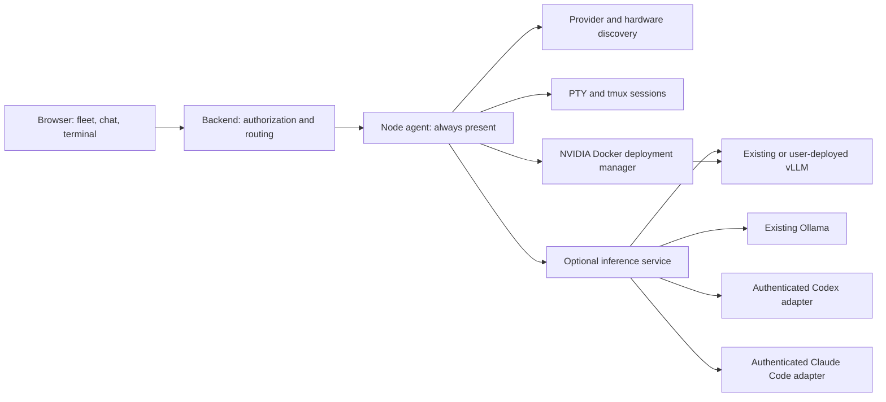

# Node services and browser terminal

Design refinement: November 8, 2026. Browser terminals (T28/T30) are implemented; the provider/service/deployment changes below still specify target behavior. It supersedes earlier assumptions that every online node must have a warm local model, that CPU inference containers are managed, or that GPU discovery starts a container. See [implementation status](./IMPLEMENTATION.md) for the current software.

## Two responsibilities on each machine

Every enrolled machine runs the **node agent**, the persistent control service. It inventories hardware, discovers providers and their models, checks provider authentication, publishes capabilities, reconciles work, manages eligible Docker deployments, and brokers browser shells. Its heartbeat and shell service work with zero inference providers.

The **inference service** is optional. It exposes a normalized execution interface over existing Ollama, authenticated Codex, authenticated Claude Code, or an explicitly selected vLLM deployment. It can live in the node-agent process initially; the distinction is a service boundary, not a requirement for another daemon. Inference failures must not stop enrollment, discovery, or terminal access.



An installation without a GPU can still offer a terminal, existing CPU Ollama, or hosted Codex/Claude Code access. Apple Silicon uses existing native Ollama for local acceleration in this demo. The demo does not add automatic native model-server deployment.

## Discovery and authentication

“Logged in” means provider authentication for the OS user configured to run the node, independent of login to this frontend or an active desktop session. The initial deployment uses one configured non-root OS user per machine. A daemon running under a different account cannot claim another user's CLI login. Supporting multiple OS users later requires separate user-scoped agents and authorization.

| Provider      | Discovery rule                                                                                   | Models and ownership                                                                                               |
| ------------- | ------------------------------------------------------------------------------------------------ | ------------------------------------------------------------------------------------------------------------------ |
| Ollama        | Inspect the configured local endpoint; no Codex/Claude login gate                                | Inventory installed models; observe loaded models separately. Treat the daemon and its models as externally owned. |
| Codex         | Detect installation/version, then check authentication; enumerate models only when authenticated | Use a version-pinned local app-server adapter. Keep provider credentials on the node.                              |
| Claude Code   | Detect installation/version, then check authentication; enumerate models only when authenticated | Use a version-pinned adapter and supported model metadata. Keep provider credentials on the node.                  |
| Existing vLLM | Inspect explicitly configured local endpoints                                                    | Observe served models without adopting or restarting the external process/container. No arbitrary port scan.       |
| Managed vLLM  | Inspect Docker and NVIDIA eligibility; inspect only owned deployment records                     | No instance exists until a user requests a catalog deployment.                                                     |

Ollama provides installed-model inventory through `GET /api/tags`; inventory itself need not generate tokens. [Ollama list models](https://docs.ollama.com/api/tags)

For Codex, use initialized app-server RPC, `account/read` for auth and paginated `model/list` after auth succeeds. Catalog entries do not prove account entitlement; record catalog freshness and access as unverified until actual execution establishes it. Do not make a generation request during discovery. [Codex app-server](https://learn.chatgpt.com/docs/app-server), [catalog versus access](https://developers.openai.com/siwc/token-sharing-open-source/codex-app-server)

For Claude Code, the documented `claude auth status` command supplies authentication status. Model discovery must use a supported structured surface from the pinned CLI/SDK version; the SDK documents `supportedModels()`. Apply configured provider and organization restrictions and retain aliases separately from resolved model IDs. If the installed version cannot enumerate reliably, expose `model_discovery_unsupported`; do not invent a model list or scrape an interactive picker. [Claude CLI reference](https://code.claude.com/docs/en/cli-reference), [Agent SDK reference](https://code.claude.com/docs/en/agent-sdk/typescript), [model configuration](https://code.claude.com/docs/en/model-config)

Initialize provider metadata sessions without submitting a prompt, enabling workspace hooks/extensions, or granting tools; if the installed version cannot do that without executing user code or inference, report discovery unsupported until a safe adapter is available.

The initial account-backed path requires a valid provider login. Detect and report API-key or third-party authentication separately; enabling those paths is an explicit operator policy, not an automatic substitute for a missing login.

Probe at startup, on a bounded refresh timer, on explicit Refresh, after login/logout, and after sleep/wake. Missing installation, logged out, timeout, unsupported version, and provider outage are different results. Auth check failure yields `unknown`, never `authenticated`. Logout/account changes immediately withdraw routable models and invalidate the previous account's model cache; a stale inventory may remain visible with its timestamp. Credential material, raw auth output, and provider tokens never enter fleet metadata, terminal environment injected by the broker, or backend logs.

## Independent state and contracts

Keep these dimensions separate in the next protocol revision:

```text
Node: nodeId, bootId, leaseGeneration, controlState, hardwareRevision,
      providers[], inferenceService, dockerCapability, terminalCapability

Provider: providerId, kind, installedVersion, ownership=external|managed,
          authState=not_required|authenticated|logged_out|expired|unknown,
          discoveryState, discoveredAt, models[], lastErrorCode

Model: providerModelId, displayName, resolvedModelId?, catalogSource,
       access=unverified|verified|denied, capabilities, locality=local|hosted

InferenceService: enabled, state=disabled|unavailable|ready|draining,
                  profiles[], capacity

Deployment: deploymentId, catalogEntryId, desiredState=stopped|running,
            observedState, revision, operationId, ownedContainerId?

TerminalSession: sessionId, nodeId, ownerId, osUserRef, workspaceId,
                 backend=tmux|pty, state, createdAt, expiresAt
```

These are design shapes, not current TypeScript schemas. Use provider-qualified model/profile identities, so identical model names on Ollama and vLLM do not collide. Record execution mode (`llm_api` or `agent_session`) and supported policy controls on profiles. A CLI-backed profile may be available for dispatch without any local weights being loaded; local `warm` state does not describe hosted access.

Fresh nodes start with optional inference serving disabled and no managed deployment selected. Users can enable serving existing providers separately from deploying a model. Serving Ollama may load an installed model when a user task needs it; discovery alone does not benchmark or warm it. Existing automatic Ollama selection is current implementation behavior and needs an explicit migration to this policy. Never silently turn an old runtime manifest into permission for a new GPU deployment; obtain and persist an explicit selection through configuration or UI.

## User-selected NVIDIA deployments

The demo manager supports model inference containers only, using approved vLLM profiles on tested Linux/NVIDIA machines. NVIDIA presence is necessary, but admission also requires a working compatible driver, local Docker daemon, container GPU access, supported architecture/runtime/artifact combination, and sufficient RAM, VRAM and disk. Unsupported or unknown probes disable Deploy with a specific reason. macOS and CPU-only nodes do not offer managed inference containers.

1. The user opens a node's Deploy model panel. It contains only approved **Gemma 4** catalog entries, with incompatible choices disabled and explained. This restriction applies to the managed deployment picker; existing Ollama and authenticated provider inventories retain their actual models.
2. Selecting an entry prepares a deployment summary: exact artifact/revision, quantization, context, immutable runtime image digest, device assignment, estimated resources, and any required downloads. Selection alone does not start a container. The user clicks **Deploy and start** to persist `desiredState=running`.
3. The backend validates authorization and catalog revision, commits a deduplicated operation/outbox entry, and dispatches it. The node rechecks eligibility, provisioning policy and resource reservations at execution time. Concurrent requests cannot reserve the same capacity twice.
4. Provision only the selected artifacts if permitted. Otherwise return `artifacts_required` with provisioning instructions. Discovery, routing, health checks, and a GPU appearing never pull images or model files.
5. Create an owned, labeled container; verify model identity, readiness and a bounded warmup before advertising capacity. The inference API stays loopback/private. vLLM's documented Docker serving path provides the runtime integration; our catalog and admission rules restrict which configurations we use. [vLLM Docker](https://docs.vllm.ai/en/latest/deployment/docker/)
6. Expose progress, logs, Stop and Restart. Stop drains work, persists `desiredState=stopped`, then stops only the owned container. Keep model/cache data. Restart and model changes use revision checks and the same journaled lifecycle.

Proposed lifecycle: `unconfigured → selected → provisioning → starting → warming → ready → draining → stopped`; errors carry a reason and enter bounded backoff or `failed`. `selected` is pending UI/configuration intent, not permission to provision. Returning from stopped to running requires Start. When serving is disabled, withdraw profiles, drain work and suspend managed runtimes while retaining selection; reenabling serving may resume a previously requested running deployment. After a node restart, reconcile ownership and persisted desired state: an explicitly started deployment may recover only when serving is enabled; a stopped or unconfigured deployment must remain stopped. Never choose another model automatically on OOM. Mark unavailable and let the user choose a smaller profile.

## Execution and routing

Ollama/vLLM adapters supply model APIs to the existing Pi execution loop. Codex/Claude Code adapters run provider-native agent sessions and translate their events, cancellation and approvals to our execution protocol. They are not assumed to be OpenAI-compatible token servers. Do not nest a second Pi tool loop around a CLI agent that already executes tools. Prefer Codex app-server and the Claude Agent SDK, with versions pinned before implementation.

Every adapter must enforce the task's workspace, allowed tools, approvals and resource policy. If a version cannot enforce the requested policy or journal side effects adequately, that profile is ineligible for that task. Preserve provider session/turn IDs for reconciliation and resume; do not claim a native provider transcript can migrate losslessly to Pi or another provider.

Routing filters require a fresh node lease, enabled inference service, matching provider/model profile, current authentication where required, capacity, policy support and workspace/tool access. Hosted execution needs its own `allowHostedInference` policy; `allowHostedJudgment` controls Jev separately. Login and model listing alone do not authorize billed inference. Provider access errors withdraw the affected profile and surface a reason; never silently switch to another paid provider.

Code enforces these facts before Jev supplies semantic routing judgments. A shell request bypasses model routing. A node with inference disabled remains visible and usable for shell access. An inference-only node can serve tool-free tasks; using a different node's workspace/tools still requires T24 split placement.

## Browser shell and tmux

Use xterm.js for the browser terminal, an authenticated backend WebSocket relay, and a node-local PTY broker. The PTY attaches to a dedicated **tmux session** by default; tmux supports detaching and reattaching while programs keep running. [tmux getting started](https://github.com/tmux/tmux/wiki/Getting-Started)

```text
Browser xterm.js ⇄ authenticated WSS relay ⇄ node PTY ⇄ tmux ⇄ user shell
```

The initial backend-to-node leg can use an enrolled reachable private endpoint with authenticated WebSocket upgrade. Bind each connection to node identity and current boot/lease generation. An outbound node WSS tunnel is a later NAT-friendly transport; changing transport must preserve session ownership and authorization. The browser never connects to Docker or receives node credentials.

- **Create:** Open terminal on a node creates a session under the configured OS user and selected workspace. The browser cannot specify an arbitrary OS username, executable or host path. Use the configured user shell and fixed argument arrays. A native node is required for a host shell in this demo; a containerized node must clearly identify a container shell and cannot imply host access.
- **Attach:** Authorize both create and every attachment. Issue a short-lived, single-use attachment ticket bound to user, session, node boot and origin. Exchange it in the authenticated handshake/first frame, never in a logged URL. Validate Origin and ownership, enforce TLS outside localhost, and expire/revoke open attachments. These controls follow the terminal's direct shell privileges. [xterm.js security guidance](https://xtermjs.org/docs/guides/security/)
- **Interact:** Relay terminal bytes, bounded resize events, exit and heartbeat frames. Use bounded buffers and backpressure; slow/disconnected browsers cannot exhaust node memory. Separate terminal traffic from chat events so a noisy shell cannot block heartbeats or chat output. Initial sessions allow one active writer; a second attachment requires explicit takeover and invalidates the old writer.
- **Detach/reconnect:** Closing the tab detaches the PTY client and leaves tmux running. Reattach to the same owned session with a new ticket; restore its current screen/scrollback. Do not replay keystrokes or promise durable exactly-once terminal output. tmux's private socket directory and session mapping stay node-local; never attach arbitrary existing user sessions.
- **End:** End session terminates the owned tmux session and observes exit; it cannot undo side effects or guarantee termination of programs that daemonized. Enforce configured idle/absolute expiry and session limits, shown in the UI. Without tmux, allow explicitly labeled nonpersistent PTY mode that ends on detach; do not claim reconnect survival.

tmux sessions may survive backend or node-agent restart if the OS service manager preserves the tmux process; reconcile owned sessions before enabling reattach. They do not survive reboot, tmux failure, or a service manager killing its entire process group. Document/test service-unit behavior rather than promising restart survival unconditionally. Authorization revocation closes relay connections immediately; termination of detached sessions is a separate persisted, reconciled operation.

Shell access grants the configured OS user's command permissions. It is separately authorized from model tools and does not become safe through workspace `cwd` or a tool allowlist. A user may run provider login commands manually here; credentials remain with the provider on that node. Device-code/manual-URL flows are preferred for remote login; loopback OAuth redirects need an explicitly supported callback path and cannot be assumed to reach the node from the browser. Refresh provider discovery after login. Do not copy provider tokens through backend APIs or record raw keystrokes/output by default; audit session metadata and lifecycle instead.

## Frontend and acceptance

The left sidebar groups fleet navigation and connection controls under **MANAGE FLEET**. It contains **My cloud**, **Connection settings**, and **Disconnect** when connected. Fleet/provider, deployment and terminal management are accessed through the node views in **My cloud**.

Each node view shows control connectivity, hardware, discovered providers/authentication, optional inference availability, owned deployments and terminal sessions as separate panels. Core actions are **Refresh**, **Enable serving**, **Deploy model**, **Start/Stop**, **Open terminal**, **Reconnect**, and **End session**. A logged-out provider displays its status without routable models. A no-GPU node explains Docker unavailability and still offers its terminal.

Implementation acceptance must demonstrate:

1. A fresh node with no providers stays online; its shell works with inference disabled.
2. Codex/Claude installation alone advertises no routable models; login discovers models, logout withdraws them, timeouts report unknown, and no credentials leave the node.
3. GPU discovery and restart without a saved running selection create no container and download nothing. CPU/non-NVIDIA nodes reject deployment requests server-side, including direct API calls.
4. Only approved Gemma 4 entries deploy; duplicate operations create one owned container. Stop stays stopped across restart. Resource/auth/catalog changes between selection and execution fail safely.
5. Existing Ollama/vLLM remain externally owned. Provider-native agent sessions enforce policy, stream, cancel and reconcile without duplicate tool execution or nested agent loops.
6. A long command survives browser refresh with tmux; resize, reconnect, explicit end, expiry, writer takeover, ticket reuse, cross-user attachment and revoked access behave as specified. Node reboot is reported as session loss.
7. Runtime/Docker/provider failure leaves heartbeats and shell available. High-volume terminal output stays bounded and cannot starve the control loop.

## Implementation work packages

Browser terminal brokerage and controls (T28/T30) are implemented. Existing automatic Ollama benchmarking/selection and runtime-manifest startup still require a migration; Codex/Claude adapters and deployment controls remain future work.

| Package | Deliverable                                                                                   | Acceptance focus                                                                                  |
| ------- | --------------------------------------------------------------------------------------------- | ------------------------------------------------------------------------------------------------- |
| T26     | Provider discovery, independent control/inference/terminal state, protocol and fleet metadata | Auth-gated model lists, no generation during discovery, online nodes with zero models             |
| T27     | Codex app-server and Claude SDK execution adapters plus routing filters                       | Policy enforcement, separate hosted-inference permission, cancellation and journal reconciliation |
| T28     | Node PTY/tmux broker and backend session/WebSocket relay                                      | Ownership, tickets, revocation, expiry, bounded traffic, restart handling                         |
| T29     | Gemma 4 deployment API, lifecycle operations and frontend picker                              | Explicit selection/start, NVIDIA admission, durable operation dedupe, stopped stays stopped       |
| T30     | xterm.js browser terminal and session controls                                                | Resize, detach/reconnect/end, writer takeover, denied attachment and no keystroke replay          |

Expand shared contracts and PostgreSQL migrations first. Add provider/service state next; implement native-provider sessions and shell brokerage against those contracts. Deployment UI follows the amended catalog/supervisor; browser terminal UI follows the broker. Retain existing task IDs and amend T05/T09/T25 for NVIDIA-only explicit deployment. Full dependencies and proposed endpoint/storage additions are maintained in the local [research backlog](./research-docs/implementation-tasks.md) and [API design](./research-docs/backend-routing.md).

## Chat working directories and project trees

Implemented refinement: with no nonempty `AGENT_WORKSPACE_DIR`, a chat's working directory is `~/.curilo/workspace/chat_sessions/<conversation-id>` on the selected node. The conversation ID is the stable session ID; follow-up turns reuse its files and separate conversations use separate directories. An explicit configured project remains the task workspace. Files from the earlier default directory are not moved automatically.

The node automatically publishes the parent as **chat_sessions** under **Projects@<node name>**, using directory basenames as display names. Projects form an expandable tree of directories and file names, loaded one directory at a time. Operator-added project roots persist on the node; older browser entries are imported. Browse registration is distinct from permission to execute model tools in that root.

Authenticated backend project APIs relay to enrolled, allowlisted online nodes. The node returns at most 200 directory entries per page with an offset for more; expanded frontend branches refresh every three seconds. Only approved project roots can be listed. Paths cannot escape a root, private node state is excluded, and symbolic links appear as nonexpandable leaves. This is a directory browser, not a file editor or filesystem synchronization mechanism.
